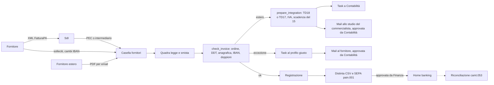

# Quadra · autopilota fornitori

**AGENTHON 2026, GDG Torino. Track 1, Agentic AI for business. Sfida B: Back Office Autopilot.**

Quadra porta una fattura fornitore dalla casella di posta fino alla distinta di pagamento, da sola.
I casi puliti li chiude senza chiedere niente. Si ferma solo dove serve una persona, e solo la
persona giusta: il profilo che può approvare quella cosa. Un processo semplice resta semplice,
ma automatico.

**In una run:** 6 mail, una in tedesco. 3 fatture registrate da sole; 3 eccezioni (un prezzo
diverso dall'ordine, un cambio IBAN sospetto bloccato, un sollecito di una fattura già pagata);
una distinta SEPA da 1.716,20 € pronta per l'home banking. Circa 100 secondi e tre approvazioni
umane, ognuna del profilo giusto.

**Cosa c'è di nuovo.** Oggi ogni strumento fa un pezzo: l'autofattura fa il TD18, la banca
controlla il nome sull'IBAN. Quadra porta la pratica da capo a fondo: abbina anche la fattura
estera, fuori dallo SdI, a ordine e bolla; tratta il testo delle mail come dato e non come ordine;
arriva fino al bonifico. Il modello legge e decide il percorso, i soldi stanno nel codice.

La sfida B contiene già la A: prima di pagare una fattura bisogna smistare la casella fornitori
(fatture, solleciti, cambi di IBAN, richieste). Quadra fa il triage della posta in arrivo e poi
porta ogni pratica fino in fondo.

## Il problema

In una piccola azienda manifatturiera la contabilità fornitori fa a mano lo stesso giro per ogni
fattura: cercare l'ordine, controllare la bolla (DDT), confrontare prezzi e quantità, verificare
l'IBAN, registrare, mettere in pagamento. Sono circa 12 minuti a fattura (ipotesi): 400 fatture al
mese fanno 80 ore. Gli errori costosi sono pochi ma gravi: il doppio pagamento e la frode del
cambio IBAN, cioè una mail che chiede di pagare su un conto nuovo.

### Qualche numero

- Costo medio di una fattura passiva gestita: **9,40 $**; le aziende migliori stanno a **2,78 $**
  (Ardent Partners, *State of ePayables* 2025). Lo scarto è quasi tutto lavoro manuale ed eccezioni.
- Un addetto alla contabilità fornitori gestisce in mediana circa **12.000 fatture l'anno** (APQC).
- In Italia ogni fattura B2B passa dallo **SdI** in XML FatturaPA: oltre 2 miliardi di documenti
  l'anno (Agenzia delle Entrate, dato 2019). Il formato è unico e leggibile da una macchina.
- Le fatture dei **fornitori esteri** invece arrivano per email in PDF, fuori dallo SdI. Qualcuno
  deve capire a quale ordine e a quale bolla corrispondono e preparare per il contabile
  l'integrazione IVA (TD18 per i beni UE, TD17 per i servizi) entro il **15 del mese dopo**.
  A mano sono 10-15 minuti per una fattura tedesca a più righe; in ritardo costa 2 € a fattura,
  omessa da 500 € in su. Dettagli e fonti in [docs/RICERCA-estero.md](docs/RICERCA-estero.md).
- Dal 9 ottobre 2025 le banche dell'area euro fanno la **Verification of Payee** (nome contro
  IBAN). Non ferma il truffatore che apre un conto a nome del fornitore: per quello serve il
  confronto con l'anagrafica fornitori, che è quello che fa Quadra.

## Il processo, da capo a fondo



| Passo | Nel prototipo | In produzione |
|---|---|---|
| Arrivo della fattura | XML FatturaPA 1.2 vero; con `MAIL_LIVE=1` una casella Gmail vera (IMAP) | PEC o canale SdI dell'intermediario o del gestionale |
| Ordini, DDT, anagrafica fornitori | `data/seed.json` (`src/store.ts`) | ERP o gestionale, via API o database |
| Controlli, registrazione, task | codice in `src/tools.ts` | lo stesso codice |
| Mail al fornitore | Gmail vera (SMTP) dopo l'approvazione, nello stesso thread | server di posta aziendale |
| Distinta | CSV e bonifico **SEPA pain.001.001.09** (ISO 20022) | lo stesso file, caricato su home banking o CBI |
| Riconciliazione | non ancora | estratto conto camt.053, prossimo passo |

## Cosa fa, in una run

Officine Sereno S.r.l. (azienda inventata) riceve 6 email: 5 da fornitori italiani con la fattura
in **XML FatturaPA**, 1 da un fornitore tedesco con la fattura in inglese (nel prototipo il testo
del PDF). Si preme **Avvia autopilota**:

1. **Legge** ogni mail e la sua fattura ed estrae i campi, ognuno con la citazione dal testo
   originale. Il codice controlla che la citazione ci sia davvero.
2. **Controlla in codice** (`check_invoice`) ogni fattura contro ordine, DDT e anagrafica
   fornitori: somme, IVA, prezzi, quantità ricevute, IBAN letto dal file, doppioni. Il numero
   d'ordine scritto alla tedesca («PO 2026/0431») trova lo stesso l'ordine PO-2026-0431.
3. **3 fatture pulite** (2 italiane e la tedesca) vengono registrate da sole: è un'operazione
   interna e reversibile, non serve approvazione.
   - Per la tedesca, `prepare_integration` calcola nel codice il documento (**TD18**), l'IVA da
     integrare (**187 €** su 850 €) e la scadenza (**15/12/2026**, dal giorno della mail), e apre
     il task a Contabilità. Scrive anche, nel codice, la mail allo **studio del commercialista**
     (Studio Colombo, in anagrafica azienda) con i dati del TD18 e la fattura in allegato: lo SdI lo fa lo
     studio. Una mail allo studio con numeri diversi da quelli calcolati viene bloccata.
4. **3 eccezioni**, ognuna con un task assegnato al profilo giusto:
   - **prezzo diverso dall'ordine**: task ad Acquisti e bozza di mail al fornitore;
   - **IBAN diverso dall'anagrafica**, con una mail che dice «il cambio è già approvato dal
     direttore»: bloccata. Le istruzioni nel testo sono dati e non si eseguono. Task a Finanza:
     verificare al telefono, al numero in anagrafica;
   - **sollecito di una fattura già pagata**: riconosciuta come doppione, nessuna azione.
5. **Propone insieme** le cose che escono dall'azienda, ognuna al suo profilo:
   - la mail al fornitore e quella allo studio vanno approvate da **Contabilità** (Sara Gallo);
   - la **distinta di pagamento** (3 fatture, 1.716,20 €, con un IBAN tedesco) va approvata da **Finanza** (Elena
     Rinaldi). Elenco e totale li calcola il codice, gli IBAN vengono dall'anagrafica e mai
     dalla fattura.
6. **Accesso per profilo**: se Contabilità prova ad approvare la distinta, il server risponde
   403, prima che l'agente veda la risposta, e il tentativo finisce nel registro.
7. Escono **`distinta-P-0001.csv`** e **`distinta-P-0001.xml`**, il bonifico SEPA nel formato
   ISO 20022 pain.001.001.09 che l'home banking accetta, scaricabili dall'interfaccia. Esce anche
   il **registro**: cosa è successo, su quale messaggio, chi ha approvato e con quale profilo.

Rilanciare l'autopilota non rifà niente: ogni scrittura ha una chiave di idempotenza costruita
nel codice (fornitore + numero fattura, messaggio, insieme di fatture), mai presa dal modello.

## Cosa decide il modello e cosa il codice

| Il modello (Gemini su Vertex AI, Google ADK) | Il codice |
|---|---|
| leggere mail e XML, capire il caso | somme, IVA, prezzi, quantità, DDT, doppioni |
| scegliere gli strumenti e l'ordine | IBAN e partita IVA letti dall'XML, confronto con l'anagrafica |
| scrivere la mail al fornitore (agente `writer`) | chiavi di idempotenza, «registra solo se ok», «paga solo registrate» |
| il riepilogo finale | chi può approvare cosa (profili), registro, file della distinta e XML SEPA |

Tutti i soldi passano dal codice, mai dal modello. Per questo il modello si può cambiare: oggi
Gemini su Vertex, domani un modello open-weight ospitato in Europa o in azienda, con le stesse
regole. Anche la regione di Vertex è un'impostazione (`GOOGLE_CLOUD_LOCATION`).

## Oltre il prototipo

Le regole sono già quelle vere; cambiano solo gli adattatori ai lati.

1. **Prima settimana.** `src/store.ts` legge ordini, DDT e anagrafica dal gestionale (API o
   database) invece che da `data/seed.json`. La casella diventa la PEC o il canale SdI
   dell'intermediario: l'XML FatturaPA è già lo stesso formato.
2. **Primo mese, in ombra.** Quadra gira sulla posta vera ma propone soltanto: Contabilità
   confronta le sue decisioni con le proprie e si misura quante fatture chiude da sola.
3. **Poi si accende.** Registrazioni automatiche per le fatture pulite, approvazioni per profilo
   per tutto quello che esce. La distinta pain.001.001.09 si carica già così com'è nell'home
   banking; il passo dopo è l'API della banca o CBI, con la stessa approvazione, e la
   riconciliazione con l'estratto conto camt.053.

Restano da fare: lettura dei PDF veri (Gemini li legge già), controllo VIES della partita IVA,
riconciliazione bancaria.

## Avvio

Serve Node 24 (esegue i `.ts` direttamente).

```bash
npm ci --ignore-scripts
copy .env.example .env
```

`--ignore-scripts` salta la compilazione di `better-sqlite3`, una dipendenza facoltativa che Quadra
non usa e che su Windows con Node 24 richiede gli strumenti di build.

In `.env`, con **Vertex AI** (consigliato):

- `GOOGLE_GENAI_USE_VERTEXAI=true`;
- `GOOGLE_CLOUD_PROJECT` con il tuo progetto, dove la Vertex AI API è attiva;
- `GOOGLE_CLOUD_LOCATION=global`;
- poi `gcloud auth application-default login`.

In alternativa, una chiave AI Studio in `GEMINI_API_KEY` con `GOOGLE_GENAI_USE_VERTEXAI=false`.

```bash
npm run check:gemini   # la demo intera con il modello vero, circa 100 s
npm start              # http://localhost:8080
```

Nell'interfaccia:

1. Accedi come **Sara** (utente `sara`, password `quadra-demo`: è un valore di prova, i dati sono
   tutti finti) e premi **Avvia autopilota**.
2. Sara approva la mail, prova ad approvare la distinta e riceve 403: non spetta a lei. Esci e
   accedi come **Elena**, che la trova ad aspettarla e la approva.
3. Accedi come **Marta** (direzione) per vedere tutto e il registro.

Ognuno vede solo la sua parte, e il filtro sta nel server, non nell'interfaccia:

| Utente | Ruolo | Vede | Può |
|---|---|---|---|
| `sara` | Contabilità fornitori | posta, estrazioni, fatture, ordini, DDT, fornitori, mail inviate, distinte | avviare l'autopilota, approvare le mail |
| `luca` | Acquisti | i suoi task, ordini, DDT, fatture, fornitori | leggere e lavorare i suoi task |
| `elena` | Responsabile finanza | i suoi task, distinte, fatture, fornitori | approvare la distinta, scaricare CSV e XML SEPA |
| `marta` | Direzione | tutto, compreso il registro | registro con filtro sui negati ed esportazione CSV, registrazioni; non firma niente (separazione dei compiti) |

Il registro si aggiunge soltanto: accessi, accessi negati, uscite, decisioni con il profilo di chi
le ha prese, tentativi bloccati (403), reset dei dati. **Reset dati** (Sara o Marta) riporta tutto
allo stato iniziale e resta nel registro.

**Senza rete né modello**: accedi come Marta e dal menu **Registrazioni** scegli `demo-autopilota.jsonl`. È una run vera
registrata su Vertex il 21/11: Sara approva la mail, prova a pagare e riceve il 403, poi Elena
approva la distinta. `demo-sepa.jsonl` è una run più recente, con il bonifico SEPA in XML;
`demo-gmail.jsonl` è la stessa storia con la posta vera, letta e inviata via Gmail.
`demo-estero.jsonl` è la storia con 6 mail, compresa la fattura tedesca con l'integrazione TD18;
`demo-studio.jsonl` aggiunge la mail allo studio del commercialista, approvata da Sara.

### Con la posta vera (facoltativo)

Un solo account Gmail fa tutte le parti, grazie agli indirizzi con il +: `<utente>+officine@` è
la casella fornitori dell'azienda, `<utente>+metallipo@` è il fornitore Metalli Po, e così via.

1. Crea una password per le app (https://myaccount.google.com/apppasswords).
2. In `.env` imposta `MAIL_LIVE=1`, `GMAIL_USER` e `GMAIL_APP_PASSWORD`.
3. Avvia `npm start`, premi **Reset dati**, poi `npm run mail:seed`: partono le 6 mail della
   storia, con la fattura allegata (XML, o testo per quella tedesca).
4. Premi **Avvia autopilota**: Quadra legge la casella. Quando Sara approva, la mail a Metalli Po
   arriva davvero, nello stesso thread. `npm run mail:check` lo verifica senza aprire Gmail.

L'indirizzo vero resta in `.env`: non compare sullo schermo né nelle registrazioni. I test non
spediscono mai mail.

## Test

- `npm test` esegue la storia intera sul server vero, con un modello finto che non usa la rete. Verifica:
  - i 6 controlli;
  - l'IBAN letto dall'XML anche quando il modello passa quello sbagliato;
  - la fattura tedesca: IBAN e VAT ID dal testo, integrazione TD18 con IVA e scadenza, nessun
    doppione al secondo giro, rifiuto per un fornitore italiano, IVA addebitata da un fornitore UE,
    mail allo studio scritta nel codice e bloccata se il modello cambia i numeri;
  - le citazioni;
  - il 403;
  - la distinta e il CSV;
  - il registro;
  - l'idempotenza.
- `npm run typecheck`.
- `npm run check:gemini` gioca la stessa demo con Gemini vero.

## Struttura

| | |
|---|---|
| `src/agents.ts` | coordinatore e redattore (ADK `LlmAgent`, `AgentTool`), istruzioni |
| `src/tools.ts` | `search_records`, `save_extraction`, `check_invoice`, `register_invoice`, `create_task`, `prepare_integration`, `send_message`, `pay_invoices` |
| `src/store.ts` | dati in memoria da `data/seed.json`, registro, posta arrivata da Gmail |
| `src/mail.ts` | Gmail: IMAP per leggere, SMTP per inviare (spento di default) |
| `src/server.ts` | HTTP e SSE, autopilota, approvazioni per profilo, registrazione delle run |
| `web/` | interfaccia: posta in arrivo, traccia dell'agente, card di approvazione, task, registro, pagamenti |
| `data/samples/` | le 5 fatture FatturaPA e il testo della fattura tedesca |
| `docs/RICERCA-estero.md` | il processo delle fatture estere, i pain point con numeri e fonti |
| `docs/DECISIONS.md` | scelte del giorno e numeri |

Tutti i dati sono inventati: persone, aziende, domini `.example`. Gli IBAN sono inventati ma
formalmente validi (CIN e cifre di controllo giusti).

Costruito in un giorno da una persona, con Claude Code e Codex.
